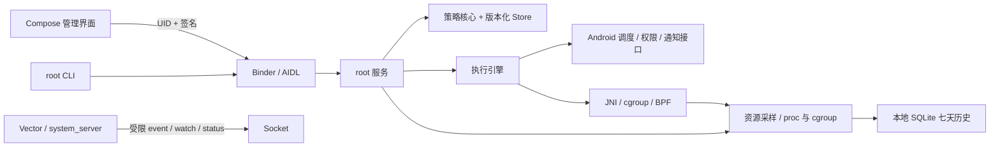

# 架构与兼容边界

## 模块职责

- `core`：默认值、继承、字段校验、类型化规则、受限旧规则转换；纯 JVM 单元测试。
- `app/ui`：Material 3 管理界面。配置来自服务，界面不维护第二份持久策略库。
- `app/service`：Binder UID 鉴权、命令、应用目录、原子配置存储、资源执行与审计；`Cli` 与界面复用协议。
- `app/hook`：现代 libxposed API 102 钩子，在 system_server 内观察/拦截系统路径并消费策略快照。
- `native`：JNI、BPF 控制工具、令牌桶网络程序。固定限速采用超限丢包，保留 Android 原网络检查。
- `probe` / `design-preview`：分别提供真实设备验证工具、隔离的 UI 演示。

## 状态与执行

配置的 `revision` 在持久化写入时增加。系统钩子异步接收快照，以 `hookRevision` 报告已消费版本；执行引擎根据模式、前台状态和能力应用限制。命令成功不意味着所有异步路径已经执行，应同时检查状态和错误。

逐应用例外优先于角色保护，角色保护优先于默认模板。权限和资源可作用于共享 UID，因此服务预检拒绝冲突配置。前台、活动任务与音频状态影响后台资源豁免；网络固定速率不随前台状态自动取消。

## 平台依赖

当前仅构建 arm64，面向 Android 16 主用户。使用 Android 私有系统接口、特定 cgroup 文件、Magisk SELinux 工具和 Vector API 102。API 注册成功不保证每个 ROM 的内部签名与内核行为相同。新增平台需补充实机证据，不能仅修改 SDK 版本号宣称兼容。

关键服务目录包含系统角色和一组现有兼容包；这些是策略保护规则，不是设备身份或账户数据。可通过逐应用显式规则审查和覆盖。项目没有云端服务，也没有账户登录系统。

## 资源管理

资源采样独立于策略 IPC，页面可见时每两秒读取、后台每分钟读取。进程名匹配持久规则，boot ID／PID／启动时间识别进程实例；网络以 socket cgroup 关联进程，应用 UID 和进程预算同时约束。历史与采集开关独立保存，规则随配置方案切换。详见 [资源统计与进程策略](resources.md)。
