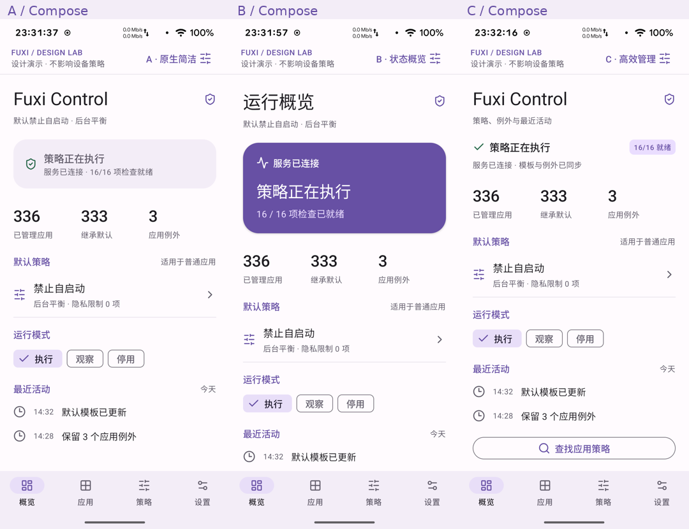

# 原生 Compose 三版 UI

这些是独立应用 **Fuxi Design** 在 Xiaomi 13 上实际运行的截图，不是 Canva 生成图。
三版共用 Material 3 色彩、Lucide 矢量图标及相同演示数据。

| 方向 | 四页总览 | 概览 | 应用 | 应用策略 | 默认模板 |
| --- | --- | --- | --- | --- | --- |
| A 原生简洁 | [四页](A-contact.png) | [查看](A-overview.png) | [查看](A-apps.png) | [查看](A-detail.png) | [查看](A-template.png) |
| B 状态概览 | [四页](B-contact.png) | [查看](B-overview.png) | [查看](B-apps.png) | [查看](B-detail.png) | [查看](B-template.png) |
| C 高效管理 | [四页](C-contact.png) | [查看](C-overview.png) | [查看](C-apps.png) | [查看](C-detail.png) | [查看](C-template.png) |

长页可滚动，底部操作区和导航固定；单张截图展示首屏。CPU/内存等摘要项目前仅展示，尚未接入真实策略编辑。
示例总数 336、继承 333、例外 3 是演示数据；列表只展示 5 个样例。

## 操作与开发

打开手机上的 **Fuxi Design**，右上角切换版本。底部进入应用、策略、设置；设置内可演示服务断开和版本冲突。
Android Studio 打开项目根目录，选择 `design-preview` 模块运行，`DesignActivity.kt` 包含 12 个 412 × 915dp 的 Compose Preview。
源码和构建说明见 [design-preview/README](../../design-preview/README.md)。

此应用只改变预览界面的临时状态，不调用 root 服务，也不覆盖已安装的 Fuxi Control。

## 已验证

- `:design-preview:assembleDebug` 和 `:design-preview:lintDebug` 通过；lint 无错误，保留仓库既有依赖版本提示。
- 实机验证 A/B/C 切换、应用筛选和详情导航。
- 上传速率 0 显示字段错误，保留输入；未保存离开提示可继续编辑。
- 保存确认、恢复继承、断线只读与重连、版本冲突重新加载、模板影响范围确认通过。
- 已补拍 A 应用列表；最终 C 详情及模板为紧凑排版。

状态截图：[版本切换](version-picker.png) · [筛选](filter.png) · [输入错误](invalid-rate.png) · [未保存](unsaved.png) · [断线](disconnected.png) · [冲突](conflict.png) · [模板确认](template-confirmation.png)。

验证脚本：`tools/test_design_ui.py --serial DEVICE_SERIAL`。截图拼图使用 `tools/design_contact_sheet.py`（需要 Pillow），只缩放排列原始截图。
